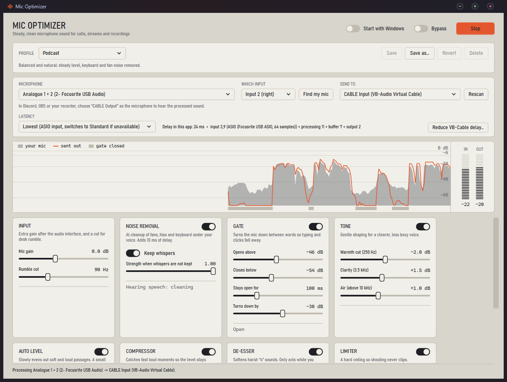

# Mic Optimizer

Real-time microphone processing for Windows that makes an ordinary condenser mic behave like a podcast mic: **steady volume, whispers that stay audible, and keyboard clicks, mouse noise and fans that disappear**. It sits between your audio interface and the apps that use your mic (Discord, OBS, Teams, a recorder) and applies a tuned processing chain with switchable profiles.



*The live trace shows your raw mic (grey) against what is sent out (vermilion), with a strip marking when the gate was closed.*

Built for a Blue Spark microphone on a Focusrite Scarlett Solo. It has been tested on that setup only (see [Status and limits](#status-and-limits)).

## What it does

```
mic ─▶ rumble cut ─▶ noise removal ─▶ gate ─▶ tone ─▶ auto level ─▶ compressor ─▶ de-esser ─▶ limiter ─▶ VB-Cable ─▶ your apps
```

| Stage | Purpose |
|---|---|
| **Rumble cut** | High-pass filter (90 Hz default) for desk thumps. |
| **Noise removal** | [RNNoise](https://gitlab.xiph.org/xiph/rnnoise) neural suppression for fans, hiss and keyboard noise under your voice. *Adaptive*: RNNoise treats whispers as noise, so the cleaned signal is only used while it hears normal or loud speech. Costs 10 ms. |
| **Gate** | A downward expander that turns the mic down between words. Its open/close decision listens only to 150 Hz to 5 kHz, so low-frequency desk thump from typing does not open it, while a whisper does. |
| **Tone** | Mild EQ: a cut around 250 Hz, a lift around 3.5 kHz, and a high shelf above 10 kHz. |
| **Auto level** | A slow gain rider that evens out soft and loud passages. Its range is deliberately small so whispers still sound softer than shouts. It never raises the gain on room noise. |
| **Compressor** | Soft-knee compression for fast peaks. |
| **De-esser** | A split-band (Linkwitz-Riley) sibilance reducer that only acts while you speak normally, never on whispers. |
| **Limiter** | A lookahead brickwall limiter so shouting never clips. |

### The app

- **Profiles**: Podcast, Whisper / ASMR, Loud / Gaming and Flat. Edit any of them, then Save, Save as, Revert or Delete. Changes apply live while you drag a slider. Profiles are JSON files in `%APPDATA%\MicOptimizer\profiles`.
- **Tray**: closing the window keeps processing in the tray. The menu has Start/Stop, Bypass, a profile switcher and Start with Windows.
- **Start with Windows**: starts hidden in the tray at sign-in and reconnects by itself if your interface or the virtual cable is not ready yet, or is unplugged and plugged back in.
- **Find my mic**: speak for three seconds and it picks the right input channel of your interface.
- **Latency readout**: shows exactly where the milliseconds go (see [Latency](#latency)).

## Requirements

- Windows 10 or 11, 64-bit.
- [VB-Cable](https://vb-audio.com/Cable/) (free virtual audio device). Mic Optimizer sends the processed audio to *CABLE Input*, and your apps use *CABLE Output* as their microphone. The app shows a banner with a download button if it is missing.
- A microphone on an audio interface or any Windows recording device running at **48 kHz** (the same rate as your output device; RNNoise requires 48 kHz).
- Optional: your interface's ASIO driver, for the lowest input delay.

## Install

**From source** (see [Build](#build)): run `build-installer.ps1` to produce `artifacts\installer\MicOptimizer-Setup-<version>.exe`. The installer is per-user (no administrator rights), self-contained (no .NET runtime to install) and offers Start with Windows and a desktop shortcut. It is **unsigned**, so Windows SmartScreen will show an "unknown publisher" warning.

Or just run it without installing: `dotnet run --project src/MicOptimizer.App`.

## Quick start

1. Install VB-Cable, then open Mic Optimizer.
2. Choose your microphone. If you are not sure which input of your interface carries it, press **Find my mic** and speak.
3. Leave **Send to** on *CABLE Input*.
4. In Discord, OBS, Teams or your recorder, choose **CABLE Output (VB-Audio Virtual Cable)** as the microphone.
5. Turn off the *Direct Monitor* button on your interface if you want to hear only the processed sound in your headphones.
6. Pick a profile. Use **Bypass** to compare against the raw mic.

On Windows 11 new tray icons start collapsed under the `^` arrow; drag the icon out once to keep it visible.

## Latency

The window shows a live breakdown. Measured on the author's setup (Scarlett Solo, VB-Cable at its default setting):

| | ASIO input | Windows audio |
|---|---|---|
| Mic input | 3.9 ms | 10 ms |
| Processing (noise removal 10 ms + limiter 1 ms) | 11 ms | 11 ms |
| Buffer and output | about 8 ms | about 9 ms |
| **Delay inside Mic Optimizer** | **about 24 ms** | **about 30 ms** |
| VB-Cable's own buffering (measured separately) | about 60 ms | about 60 ms |

How it gets there:

- Windows' low-latency shared-mode streams with real-time thread priority.
- An optional **ASIO input** (Latency mode *Lowest*, the default), which falls back to Windows audio automatically if the driver cannot be opened. Other apps could still record from and play to the interface while ASIO was open.
- A small drift-correcting buffer between the two devices' clocks. When the clocks disagree it drops or repeats a single sample every few hundred samples (inaudible on speech), so the delay neither grows nor runs dry. Its cushion starts at about 6 ms and grows only if audio ever runs dry.

**The largest remaining delay belongs to VB-Cable.** A click written straight into CABLE Input takes about 60 ms to appear on CABLE Output with none of this app involved. VB-Cable's control panel has a *Max Latency* setting (the **Reduce VB-Cable delay** button opens it; changing it needs administrator rights). The `latency` command of the probe tool prints the cable-only number so you can see the effect of changing it.

Turning noise removal off (the Whisper profile does) saves another 10 ms.

## Build

Requires the [.NET 10 SDK](https://dotnet.microsoft.com/download) on Windows.

```powershell
dotnet build
dotnet test                       # 28 tests: DSP stages, profiles, the elastic buffer
powershell -ExecutionPolicy Bypass -File build-installer.ps1   # tests, publish, installer
```

`build-installer.ps1` needs [Inno Setup 6](https://jrsoftware.org/isinfo.php) (`winget install JRSoftware.InnoSetup`). `tools\make-icon.ps1` regenerates the app icon.

### Project layout

```
src/MicOptimizer.Core    DSP stages, the processing chain, profiles (no audio devices, fully testable)
src/MicOptimizer.Audio   WASAPI and ASIO capture, the render path, the elastic buffer, latency accounting
src/MicOptimizer.App     WPF window, tray, settings, start-with-Windows
tests/                   xUnit tests (synthetic tones, drift simulations)
tools/MicOptimizer.Probe Command-line developer tool (below)
installer/               Inno Setup script
```

### Probe tool (developer utility)

`dotnet run --project tools/MicOptimizer.Probe -- <command>` is how the defaults were measured and tuned:

| Command | What it does |
|---|---|
| *(none)* | List input and output devices |
| `run [seconds] [asio] [bypass]` | Run the engine with a text meter and glitch counter |
| `calibrate` | Guided recording of silence, typing, whisper, speech and shouting, saved to `calibration/` (git-ignored) |
| `offline`, `tune`, `dyn` | Run the recordings through the chain and compare or search settings |
| `meter`, `diag` | Windows' own level meter versus raw capture, per channel |
| `latency`, `jitter` | Click-to-click delay of the old and new pipelines, the cable-only floor, callback timing |
| `latinfo`, `asioinfo` | What each device and ASIO driver supports |

The calibration recordings are your own voice and are never committed (`*.wav` and `calibration/` are ignored).

## Status and limits

- **Tested on one setup**: Blue Spark + Focusrite Scarlett Solo (Focusrite USB ASIO) + VB-Cable on Windows 11. The defaults were tuned against that voice and room; expect to adjust the gate thresholds for yours.
- Only the **Podcast** profile was tuned against recordings. Whisper / ASMR and Loud / Gaming are reasoned starting points.
- **Mono**: one input channel is used. 48 kHz only for noise removal.
- WASAPI exclusive mode does not work with the Focusrite driver (it rejects the formats), so it is not offered.
- It is a tray app, not a Windows Service: services run in session 0 and Windows often blocks microphone access there.
- The installer is unsigned.

## Credits and license

Mic Optimizer is released under the [MIT License](LICENSE). Third-party components are listed in [THIRD-PARTY-NOTICES.md](THIRD-PARTY-NOTICES.md): [NAudio](https://github.com/naudio/NAudio), [RNNoise](https://gitlab.xiph.org/xiph/rnnoise) and its .NET wrapper. VB-Cable is a separate product by VB-Audio, installed by you and not included.
